<div align="center">

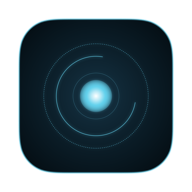

# T.R.I.S.T.A.N.

**A native macOS harness for AI coding agents, wrapped in an Iron Man style heads-up display.**

**T.R.I.S.T.A.N.** = **T**actical **R**easoning **I**nterface for **S**upervising **T**asks, **A**gents and **N**etworks.

[](https://github.com/mariotristan/jarvis-tristan/actions/workflows/ci.yml) [](https://github.com/mariotristan/jarvis-tristan/actions/workflows/secret-scan.yml) [](LICENSE)          

<p align="center">
  <a href="https://mariotristan.github.io/jarvis-tristan/"></a>
  <a href="https://github.com/mariotristan/jarvis-tristan/releases/latest"></a>
  <a href="https://mariotristan.github.io/jarvis-tristan/install.html"></a>
  <a href="https://github.com/mariotristan/jarvis-tristan/issues/21"></a>
</p>

<p align="center">
  <b>Guides:</b>
  <a href="https://mariotristan.github.io/jarvis-tristan/providers.html">Providers</a> ·
  <a href="https://mariotristan.github.io/jarvis-tristan/approvals.html">Approvals</a> ·
  <a href="https://mariotristan.github.io/jarvis-tristan/local-models.html">Local models</a> ·
  <a href="https://mariotristan.github.io/jarvis-tristan/kids-mode.html">Kids safe mode</a> ·
  <a href="https://mariotristan.github.io/jarvis-tristan/iphone-ipad.html">iPhone and iPad</a> ·
  <a href="https://mariotristan.github.io/jarvis-tristan/install.html">Install</a>
</p>

</div>

You give Tristan a task ("add login to the API"). It works inside a project folder on your Mac, the way Claude Code does. You watch it think, write code and run commands through a glowing HUD, a notch overlay and a lot of animation. Before it edits files or runs commands, it asks you first.

> **Just for fun.** Tristan is a hobby project and a learning experiment that I build together with my kids. We pick the features, draw the themes, and try things to see what happens. That is why there is a Paw Patrol-style theme, a kids safe mode and a lot of sound effects. It is not a commercial product, and it comes with no promises beyond the [MIT license](LICENSE). Ideas, issues and pull requests are very welcome.

> **Status: early experiment.** All five providers are built (Claude Code, Copilot, Bedrock, Azure OpenAI and local models through Ollama) plus a demo provider, together with the HUD, notch overlay, approvals, history, notifications and voice. 198 automated tests pass (181 for the Mac app and 17 for the iOS app), and there is an **iPhone and iPad app** (a remote for the Mac, plus a standalone mode) that runs in the simulator, but **only Claude Code and Azure OpenAI have been run against the real service end to end** (Copilot too, in `AUTO` mode). Bedrock, Ollama, Copilot's `ASK` mode, the wake word and notifications are covered by tests with fakes and still need a live run. See [known limitations](#known-limitations) for exactly what is and is not verified.

## Demo videos

Recordings of the real app on the built-in demo provider (no account or tokens needed). Click a picture to play the video.

**A task from start to finish** (37 s): the orb grows and sends out rings while Tristan works, the microphone stays off until it has answered, and the orb can fill the whole window.

[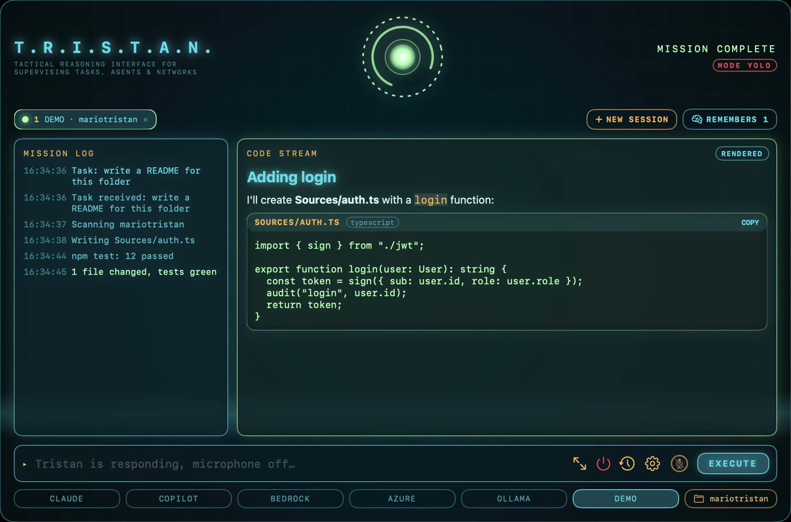](docs/demo/tristan-demo.mp4)

**Kids safe mode** (64 s): the Paw Patrol-style theme, school questions answered, and a parent PIN needed to open Settings.

[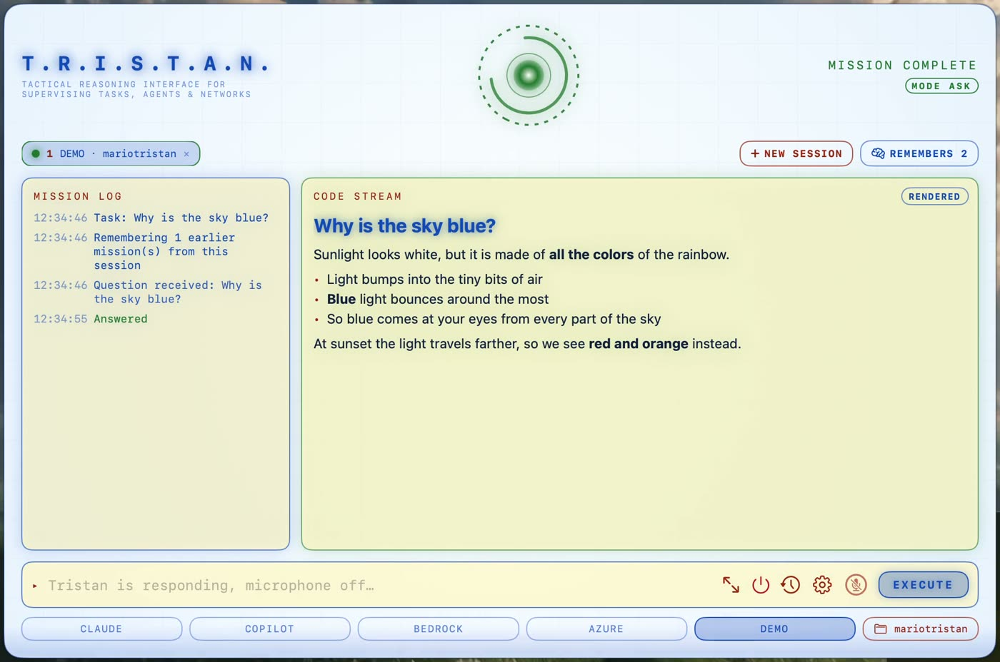](docs/demo/tristan-demo-kids.mp4)

Record them again with `scripts/record-demo.sh` and `scripts/record-demo.sh kids`. The app plays the scenario by itself (`Tristan --demo`), and the script films the screen, crops to the window and trims the end. It needs Screen Recording permission for your terminal, Xcode and ffmpeg. The demo never touches your Keychain and restores your own settings when it ends.

## Screenshots

Rendered from the real views with sample data (`Tristan --snapshot docs/screenshots`).

**The HUD while a mission runs.** Mission log on the left, code stream on the right, arc reactor on top.

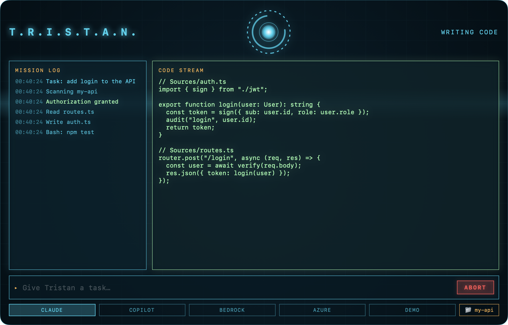

**Ask-first approval.** The reactor and borders turn amber until you approve or deny.

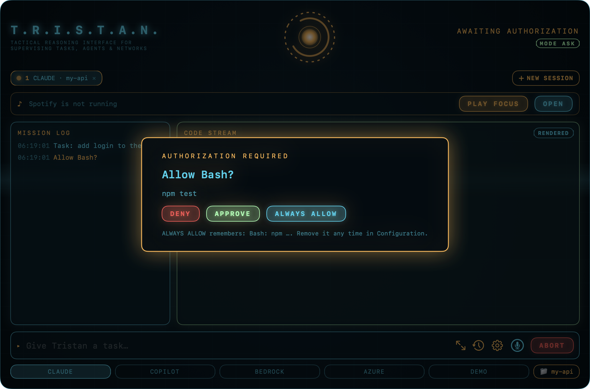

**Configuration.** Choose how much supervision a run gets.

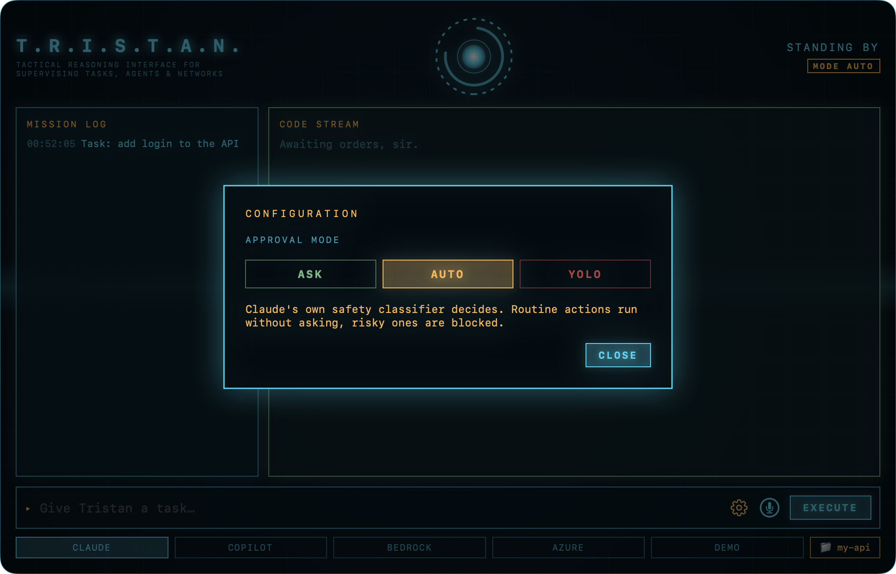

**Several sessions at once.** Each tab has its own provider, folder, log, code stream and approvals; the amber banner flags a session that is waiting in the background.

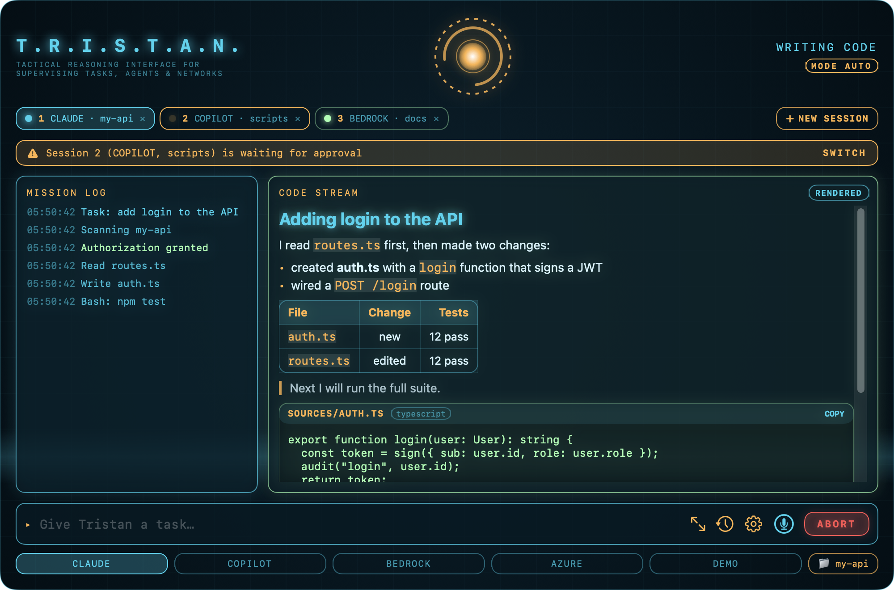

**Full screen and rendered markdown.** Full screen fills the display with larger text; the code stream renders markdown (headings, lists, tables, quotes, code cards with a copy button) and has a RAW switch.

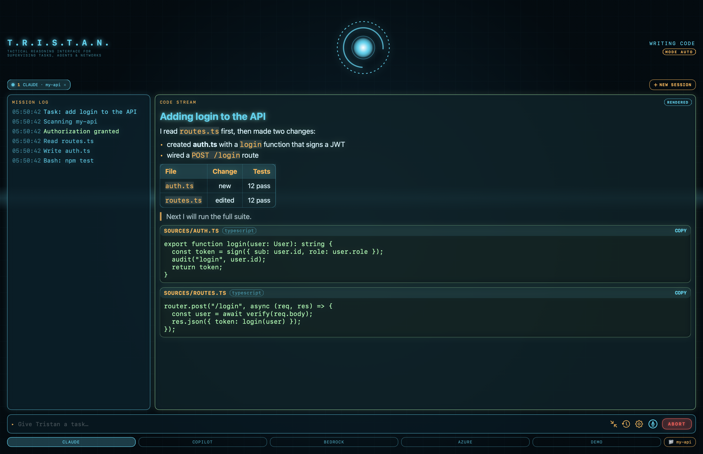

**Mission history.** Past missions with one-click re-run.

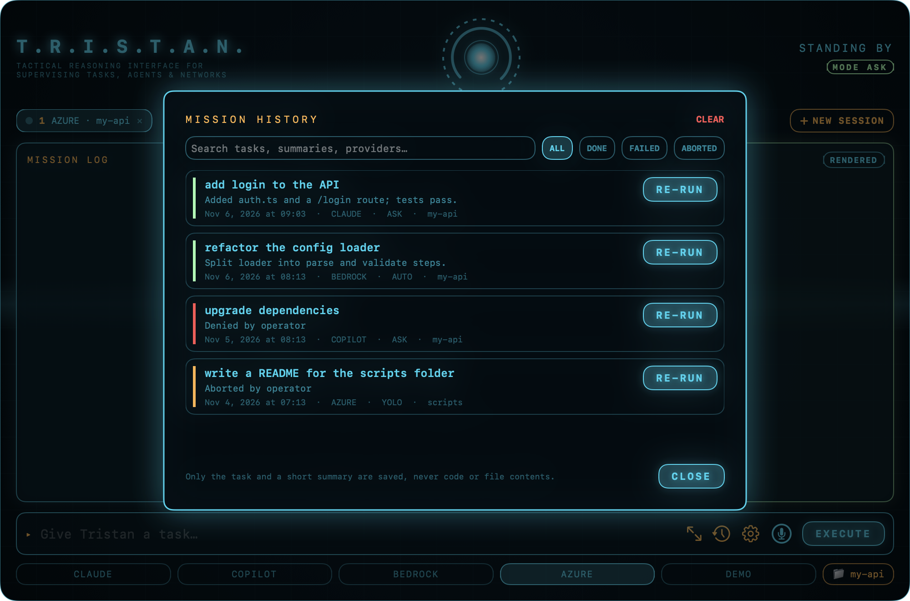

**Tristan on iPhone and iPad.** Approve from your phone while the Mac does the work (see [iPhone and iPad](#iphone-and-ipad)).

<p>
  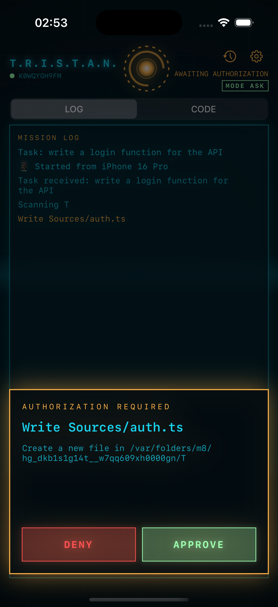
  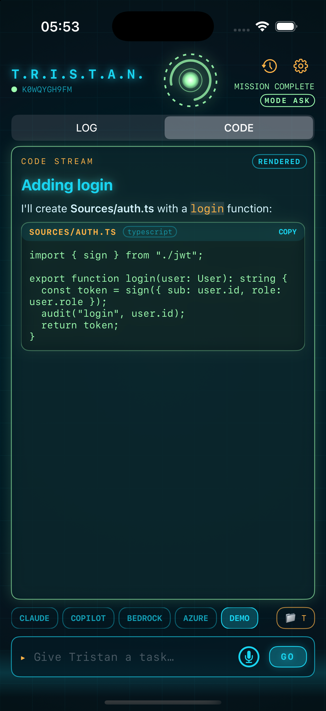
  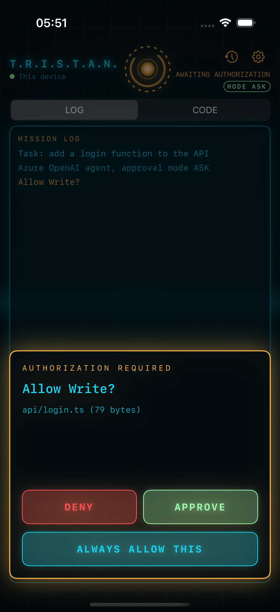
</p>

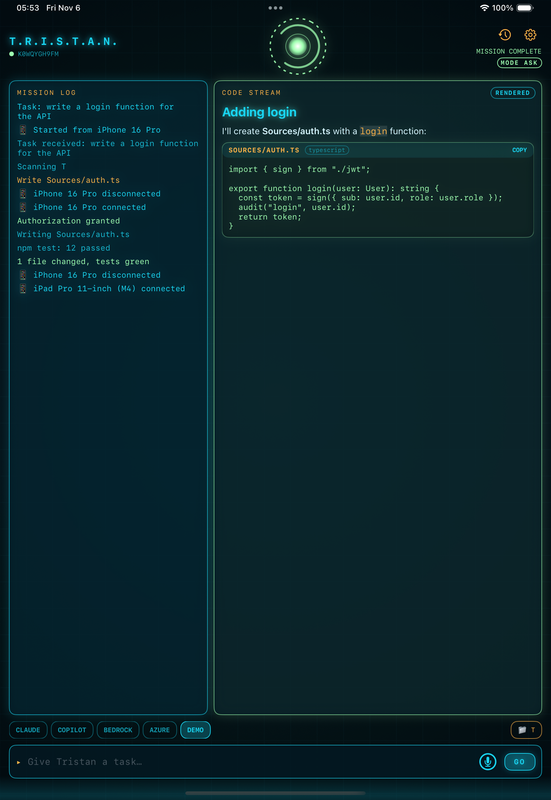

**The notch overlay**, expanded. It opens by itself when approval is needed, so you can answer without switching windows.

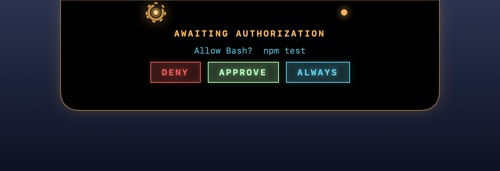

## Why

Agent CLIs are powerful but plain. Tristan is a nicer front door for them: one Mac-native app that can sit around the camera notch, summon with a shortcut, and show you what an agent is doing instead of scrolling terminal text. It is also meant to be fun, and it is a family learning project: I am building it with my kids, who test it, name things and decide what the next idea should be.

## Features

- **Full HUD window** with three areas:
  - **Mission log** on the left, a timestamped list of steps.
  - **Code stream** on the right, showing code as the agent writes it.
  - **Arc reactor** at the top, which spins and pulses faster while the agent works and turns amber, green or red for waiting, done or failed.
  - Animated grid and scanline backdrop.
- **Notch overlay.** A black pill around the camera notch with a mini reactor and a status dot. It lives on your primary display (the one with the menu bar), and so does the HUD when it opens. Hover to expand it; it opens at once, stays open while the pointer is near, and the reactor animates at a lower frame rate so it stays light on the CPU. It also opens by itself when approval is needed and for a few seconds when a mission ends. On Macs without a notch it becomes a floating pill at the top centre of the screen.
- **Ask-first approvals.** Every action Claude Code wants permission for shows up as an approve or deny prompt, in the HUD or in the notch.
- **Always allow.** The approval prompt has an `ALWAYS ALLOW` button that remembers a narrow rule so you are not asked again (see [how approvals work](#how-approvals-work)). Rules are saved between launches and listed in the configuration panel, where you can remove them one by one or clear them all.
- **Approval modes** (gear button, saved between launches):
  - `ASK`: Tristan asks before each action. This is the default.
  - `AUTO`: routine actions run without asking and risky ones are blocked or still ask (Claude: its own safety classifier; Bedrock and Azure: in-folder writes and plain commands; Copilot: a short allow-list).
  - `YOLO`: all permission checks are skipped. Needs an explicit confirmation to turn on and shows a red badge.
- **Movie-style sound and voice.** Synthesised sci-fi sounds (power-up, approval ping, mission complete, failure) and short spoken lines in a British voice: "On it, sir.", "Authorization required.", "Mission complete." Both can be switched off in Configuration. Run `Tristan --sound-demo` to hear every cue.
- **Voice (push-to-talk).** Hold `⌥ ⇧ Space` and speak, release to send, or click the mic button. The transcript appears live in the input field and the notch. For tasks started by voice, Tristan reads the result aloud.
- **The microphone shuts while Tristan answers.** From the moment you send a command, push-to-talk, the hotkey and the wake word are blocked until Tristan has finished working and speaking (plus a moment), so it never hears itself or starts a second command. The mic button shows a slashed mic meanwhile.
- **Wake word (optional, off by default).** Say "Hey Tristan, …" and stop talking; Tristan sends the command after a short silence. It uses on-device speech recognition only, so audio never leaves your Mac, and it pauses while a mission runs.
- **Mission history.** Every finished, failed or aborted mission is saved (task, provider, mode, a short summary and the folder, never code or file contents) and can be searched, filtered by outcome and re-run in one click. The file is private to you (`0600`) in Application Support.
- **Spotify (optional).** A now-playing strip with previous, play/pause, next and volume for the Spotify desktop app. Say or type short commands such as "play music", "pause", "next song", "volume 40", "what's playing" or "play my focus playlist" (set a playlist link in Configuration). These never start a coding mission and work while one is running. The music is turned down while Tristan talks or listens and restored afterwards. Works with free and Premium accounts, and needs no login or API keys (see [Spotify](#spotify)).
- **Mac notifications** when approval is needed or a mission ends while Tristan is in the background. Clicking one brings the HUD forward.
- **Global shortcut.** `⌥ Space` shows or hides the HUD from any app, and `Esc` hides it. Pick a preset or record your own combination in Configuration; Tristan tells you if another app already owns it.
- **Launch at login** switch for the installed app.
- **iPhone and iPad remote.** Start missions, watch the HUD, approve or deny actions and control Spotify from your phone or iPad, over an encrypted connection to the Mac (see [iPhone and iPad](#iphone-and-ipad)).
- **Several sessions at the same time.** Run a Claude session and a Copilot session (or two Claude sessions in different folders) side by side. Each session is a tab with its own provider, folder, mission log, code stream and approvals, and a status light (pulsing cyan while working, amber while it needs you, green when done, red on failure). **+ NEW SESSION** (`⌘T`) opens another, `⌘1`…`⌘9` switch, `⌘W` closes (a running session asks first). A session that needs approval in the background raises an amber banner, a sound, a spoken "Session 2, authorization required" and a notification, and the notch shows and answers it. Up to 8 sessions; the open sessions (provider and folder) come back after a restart. Starting a session in a folder another session is already working in warns you that edits may collide. The approval mode and always-allow rules are shared by all sessions.
- **Rounded buttons you can hit anywhere, and a big, configurable orb.** Every button is clickable over its whole area, not just on its text. While Tristan waits for the model (or listens to you) the orb grows and, with effects on, adds a breathing halo, pulse rings and orbiting sparks. **Configuration > ORB WHILE WAITING** sets the size (60 to 160%), the effects (off, subtle, full) and a switch that lets the orb fill the whole window.
- **Kids safe mode.** **Configuration > KIDS SAFE MODE**. While on, questions are answered by a local Ollama model so they stay on the Mac (see [Local models](https://mariotristan.github.io/jarvis-tristan/local-models.html)), Tristan speaks in a brighter voice, opening Settings needs a parent, and YOLO and AUTO are switched off (the mode goes back to ASK whenever it locks). A parent unlocks with a PIN (4 or more digits, stored hashed in the Keychain) or with Touch ID / the Mac password, whichever you choose. It locks again when Settings close or after 5 minutes, and paired phones cannot change the mode.
- **Session memory.** A finished mission stays in its session's context. Each session keeps the task, the actions taken and the result of its recent missions (the last 12; the newest three in detail, older ones as one line) and puts that briefing in front of the next task, so "now add tests for what you just wrote" works whichever provider runs it. Only missions from the same folder are included. The tab shows **REMEMBERS n**; click it (or open **+ NEW SESSION**, which starts empty) to forget. The memory survives a restart. On the iPhone and iPad standalone mode the same memory is kept, and **NEW CONVERSATION** in Settings clears it. The briefing is plain text in the prompt, so it costs a few thousand characters per mission at most; it is not the model's own hidden state, so details that never reached the log or the final reply are not remembered.
- **Full screen.** The expand button in the command bar, `⌃⌘F`, or the menu bar item fills the whole screen, hides the Dock and menu bar completely (they do not slide in at the edges) and puts the window above everything else, starts below the camera notch and makes the text larger. `Esc` leaves it (and so does hiding the HUD, so the Dock never stays hidden).
- **Rendered markdown in the code stream.** What an agent writes is shown as it would read: headings, bold and italic, inline code, bullet, numbered and task lists, tables with alignment, quotes, rules, and code blocks as cards with the file name, language and a COPY button. A file the agent writes is a card too, and a written `.md` file is rendered with a SOURCE switch. **RAW** shows the plain text. Links only open if they are web or mail links, so model output can never plant a `tristan://` pairing link or a `file://` link. The iPhone and iPad apps use the same renderer.
- **Greeting.** When the app opens, Tristan greets you aloud and in the mission log, for example "Good evening, sir. It is 7:42 PM on a Friday. Friday, sir. The weekend is within reach." The opening depends on the time of day (morning, afternoon, evening, late night, including "Welcome home, sir." from the first Iron Man film), it states the time and weekday, and the closing remark varies by hour and by day of the week. Speech follows the voice feedback setting, so turn **VOICE FEEDBACK** off in Configuration for a silent start. Finishing a mission can also end with "As always, sir, a great pleasure watching you work."
- **Quitting.** Several ways, so you are never stuck, even in full screen: `⌘Q` (while the HUD is in front), the red power button in the command bar, the red **QUIT** button that appears when you hover the notch, typing or saying "quit", "exit" or "close Tristan", or **Quit Tristan** in the menu bar item. There is no confirmation, even if a mission is running.
- **Themes.** Not everyone likes cyan on near-black. **Configuration > THEME** switches the whole HUD, the notch accents and the rendered markdown between 31 looks, each previewed in its own colors: Tristan (the original), Deep Blue, Graphite, Light and High contrast; pop culture (Tron, WarGames, The Simpsons, Futurama, Iron Man, Terminator, Power Rangers, Superman, Batman, Hackers, The Matrix, Peanuts, Dilbert, Garfield, Paw Patrol); dark classics (Dracula, Nord, Tokyo Night, Catppuccin, Gruvbox, Solarized Dark, Monokai, Rosé Pine); and light ones (GitHub Light, Solarized Light, Catppuccin Latte). **Match system** uses Tristan in dark mode and Light in light mode, and follows the switch live. The choice is remembered. A unit test checks that every palette keeps its text at 4.5:1 contrast or better on its backgrounds. Each theme also greets you in its own voice: an empty session (and the notch, when idle) shows one of a few welcome lines for the theme, such as "Wake up. The code is waiting." for The Matrix, and every session keeps its own line. The notch pill itself stays black so it blends with the camera notch.
- **Remembered settings.** Provider, approval mode, default folder, shortcut, sound and voice settings and provider details survive restarts. Secrets live in the Keychain.
- **Menu bar item** next to the clock to open Tristan or quit.
- **Provider switcher** along the bottom of the HUD.
- **Folder picker** to choose the project folder the agent works in.

## Providers

| Provider | Status | How it works |
|----------|--------|--------------|
| `DEMO` | Working | Scripted run with a fake approval, for trying the HUD without spending tokens. |
| `CLAUDE` | Working | Runs `claude -p <task> --output-format stream-json --verbose` in the chosen folder and turns the JSON events into log lines and code. In `ASK` mode, permission prompts are routed back to you (see [how approvals work](#how-approvals-work)). |
| `BEDROCK` | Built, needs live validation | Tristan's own agent loop on Bedrock's Converse API (see [Providers](https://mariotristan.github.io/jarvis-tristan/providers.html)). Covered by tests with a scripted model; not yet run against real AWS. |
| `COPILOT` | Built, needs live validation | Drives the GitHub Copilot CLI headlessly. Approval modes map onto the CLI's tool permissions (see [Providers](https://mariotristan.github.io/jarvis-tristan/providers.html)). |
| `OLLAMA` | Built, needs live validation | Tristan's own agent loop on a model running on this Mac through [Ollama](https://ollama.com), so nothing leaves the machine (see [Local models](https://mariotristan.github.io/jarvis-tristan/local-models.html)). Covered by tests with a scripted model; not yet run against a real Ollama model. |
| `AZURE` | Working (tested live on the Mac) | Tristan's own agent loop on an Azure OpenAI deployment, streaming tokens, tested against a real deployment with an API key (see [Providers](https://mariotristan.github.io/jarvis-tristan/providers.html)). |

Claude Code runs its own agent loop, so Tristan only has to drive it and display the output. Bedrock, Azure OpenAI and Copilot's models are models, not agents, so Tristan runs its own small agent loop for them (built for Bedrock, reusable for the rest).

### Setting up each provider

The full setup, limits and what has been tested for each provider are in the [Providers guide](https://mariotristan.github.io/jarvis-tristan/providers.html). In short:

- **Claude Code:** install and sign in to the [Claude Code CLI](https://docs.claude.com/en/docs/claude-code). Tristan finds `claude` on `PATH`, `/opt/homebrew/bin` or `/usr/local/bin`.
- **Azure OpenAI:** set the endpoint, deployment name and API version in Configuration. Paste an API key (stored in the Keychain) or leave it blank to use `az login`. The deployment's model must support tool calling. The key is only sent to `https` Azure hosts.
- **Ollama (local models):** run `scripts/setup-ollama.sh`, pick `OLLAMA`, choose a model in Configuration. Nothing leaves the Mac. See the [Local models guide](https://mariotristan.github.io/jarvis-tristan/local-models.html) or [docs/ollama.md](docs/ollama.md).
- **GitHub Copilot:** `npm install -g @github/copilot`, run `copilot` once to sign in. Its headless mode cannot ask per action, so Tristan asks once and blocks risky commands. See [Approvals](https://mariotristan.github.io/jarvis-tristan/approvals.html).
- **AWS Bedrock:** set the model id, region and optional profile; it calls the AWS CLI so your usual login works. Not yet run against live AWS.

**Kids safe mode and Ollama.** While kids safe mode is on, every question goes to Ollama so a child's questions stay on the Mac. With no usable local model nothing is sent: the child is told to ask a parent, who can allow one question to go to the cloud. See the [Kids safe mode guide](https://mariotristan.github.io/jarvis-tristan/kids-mode.html).

### Spotify

Tristan controls the **Spotify desktop app** through AppleScript, so there is no login, API key or Premium requirement. Turn on **SPOTIFY PLAYER** in Configuration. The first time, macOS asks whether Tristan may control Spotify; if you decline, allow it later in **System Settings > Privacy & Security > Automation**.

- Control commands (pause, next, volume) never launch Spotify. Only an explicit "play music" or "play my focus playlist" starts it.
- The focus playlist accepts a `spotify:playlist:…` URI or an `open.spotify.com` share link. Only well-formed identifiers are ever passed to AppleScript, so nothing else can be injected.
- **Ducking:** while Tristan speaks or listens, Spotify drops to about 30% and returns afterwards. If you change the volume yourself during that time, Tristan leaves your choice alone. Switch it off with **LOWER MUSIC WHEN I TALK**. If the app quits mid-duck, it restores the volume first.
- Commands only match whole short phrases, so a real task such as "add a pause button to the player" is never mistaken for a music command.

## iPhone and iPad

The iOS app is a **remote for the Mac**: the Mac does the real work with every provider, and the phone shows the HUD, answers approvals with large buttons and haptics, starts missions, switches provider, mode and folder, controls Spotify and browses history. Without a Mac, a **standalone mode** talks to Azure OpenAI or Bedrock directly, with file tools but no shell. Pair by switching **REMOTE CONTROL** on in the Mac's Configuration and scanning the QR code.

The link is TLS with a pre-shared key held in the Keychain on both sides; it is off by default, a phone cannot turn on `YOLO`, and **NEW SECRET** locks out every paired device. Approvals only reach the phone while the app is open in front, and it has been run in the **iOS simulator only**, not on a physical device.

The full guide (pairing, security, limits, standalone mode, running the simulator) is [iPhone and iPad](https://mariotristan.github.io/jarvis-tristan/iphone-ipad.html). The design is in [docs/superpowers/specs](docs/superpowers/specs/2026-11-06-ios-remote-design.md). Run it in the simulator with `scripts/ios-demo.sh`; the iOS project is generated with `cd ios && xcodegen generate` (needed whenever a file is added to `Sources/Tristan/Shared`).

## Install

You need an **Apple Silicon** Mac on macOS 14 or later. The full guide, with every script and troubleshooting, is [Install](https://mariotristan.github.io/jarvis-tristan/install.html).

**From a release (no Xcode needed).** Download `Tristan-<version>.dmg` from the [Releases page](https://github.com/mariotristan/jarvis-tristan/releases), then:

```bash
cd ~/Downloads && shasum -a 256 -c Tristan-0.5.0.dmg.sha256      # optional: check the download
hdiutil attach ~/Downloads/Tristan-0.5.0.dmg
cp -R "/Volumes/Tristan 0.5.0/Tristan.app" /Applications/
xattr -dr com.apple.quarantine /Applications/Tristan.app          # Tristan is ad-hoc signed, not notarized
open /Applications/Tristan.app
```

If you skip the `xattr` step, macOS says the app "cannot be opened". You can also allow it under **System Settings > Privacy & Security > Open Anyway**.

**From source** (needs the full Xcode, not just the command line tools, because SwiftUI's macros need it):

```bash
git clone https://github.com/mariotristan/jarvis-tristan.git
cd jarvis-tristan
scripts/install.sh      # builds, copies Tristan.app into /Applications and launches it
scripts/bundle.sh       # or just build Tristan.app here
DEVELOPER_DIR=/Applications/Xcode.app/Contents/Developer swift build   # a quick debug build
```

Maintainers: `scripts/make-dmg.sh` builds the DMG and `git tag vX.Y.Z && git push origin vX.Y.Z` publishes a release. See [docs/ci-and-release.md](docs/ci-and-release.md). Tristan has no Dock icon: look for the notch overlay, the menu bar icon, or press `⌥ Space`.

## Using it

1. Pick a provider along the bottom. Start with `DEMO` to see everything move.
2. Click the folder button to choose the project folder.
3. Type a task and press Return or click **EXECUTE**.
4. Approve or deny when asked, in the HUD or from the notch.
5. Watch the mission log and code stream. Click **ABORT** to stop a run.

| Key | Action |
|-----|--------|
| `⌥ Space` | Show or hide the HUD from anywhere |
| `Esc` | Leave full screen, or hide the HUD |
| `⌃⌘F` | Full screen on and off |
| `⌘Q` | Quit Tristan (also: the power button, the notch QUIT button, or type "quit") |
| `⌘T` / `⌘W` | New session / close the current session |
| `⌘1`…`⌘9` | Switch to that session |
| `Return` | Execute the task |
| Hold `⌥ ⇧ Space` | Push-to-talk, release to send |

## How it works

```
Sources/Tristan/
├── main.swift         App entry point (accessory app, no Dock icon)
├── AppDelegate.swift  HUD window, menu bar item, global hotkey, notch setup
├── Session.swift      The hub: shared settings and services, the open sessions, sound/notification/history callbacks
├── MissionSession.swift  One session: provider, folder, log, code, approvals and the task that runs it
├── Shared/ConversationMemory.swift  A session's memory of finished missions, rendered as a briefing before the next task
├── FullScreen.swift   Full-screen mode for the borderless window
├── Providers.swift    AgentProvider protocol, approval modes, Demo and Claude Code providers, stream parser
├── PermissionBridge.swift  Unix-socket server in the app plus the MCP stdio shim Claude Code calls
├── AgentLoop.swift    The shared agent loop and provider-neutral transcript types
├── BedrockProvider.swift   Bedrock backend and the AWS CLI client
├── AzureProvider.swift     Azure OpenAI backend, streaming HTTP client, SSE assembler, config validation
├── CopilotProvider.swift   Copilot CLI driver and its permission mapping
├── OllamaProvider.swift    Ollama (local) client, model discovery and provider
├── Keychain.swift     Keychain storage for provider credentials
├── History.swift      Mission history records and their private JSON store
├── BedrockStreaming.swift  SigV4 signer, event-stream decoder, ConverseStream client with CLI fallback
├── Spotify.swift      Spotify control via AppleScript, music commands, ducking
├── Shortcut.swift     Shortcut model and presets for the global hotkey
├── RemoteServer.swift Mac side of the iPhone/iPad remote (listener, commands, live updates)
├── QRCode.swift       The pairing QR code
├── Shared/            Compiled by both the Mac and iOS apps: the markdown parser and views, the agent loop and tools, Azure and Bedrock backends (SigV4, streaming), remote protocol and client, theme, models
├── Notifier.swift     Mac notifications
├── WakeWord.swift     "Hey Tristan" matcher, silence-timing state machine and on-device listener
├── SettingsView.swift Configuration and history overlays
├── AgentTools.swift   Sandboxed file and shell tools, safe-path resolution, tool policy per mode
├── Audio.swift        Synthesised sound effects and spoken lines
├── Voice.swift        Push-to-talk speech recognition
├── Snapshot.swift     Renders the README screenshots from the real views
├── HUDView.swift      The main HUD, command bar and approval overlay
├── Notch.swift        Notch geometry, overlay panel and its expand/collapse logic
├── Theme.swift        Colour roles, glow panel, arc reactor, animated backdrop
├── Themes.swift       The palettes, contrast maths and the theme picker's data
└── HotKey.swift       Global hotkey through Carbon (no accessibility permission needed)
Tests/TristanTests/    181 tests: Ollama and kids-mode routing, multiple sessions, session memory, markdown parser and renderer safety, full screen, agent loop per provider, sandbox, rules, SSE, SigV4 and event-stream, remote protocol and end-to-end remote sessions, Copilot flags, wake word, history, Spotify, shortcuts, audio, theme contrast and welcomes, greetings
ios/                   The iPhone and iPad app (XcodeGen project, standalone engine, 17 tests)
scripts/               bundle.sh (app), make-dmg.sh (installer), install.sh (build and install), setup-ollama.sh (local models, see docs/ollama.md), record-demo.sh, ios-demo.sh, ios-icon.sh
VERSION                Version number used by the scripts
docs/ci-and-release.md How CI and releases work
.github/workflows/     CI: build, test and bundle on macOS
```

A provider turns a task into a stream of events:

```swift
protocol AgentProvider: Sendable {
    func run(task: String, workingDirectory: URL, approve: @escaping Approver) -> AsyncStream<AgentEvent>
}

enum AgentEvent { case status(String), log(String), code(String), done(String), failed(String) }
```

`Session` consumes that stream and publishes state. The HUD and the notch both render from the same `Session`, so they always agree. A provider asks for permission by calling `approve(...)`, which suspends until you tap Approve or Deny.

### How approvals work

In `ASK` mode Tristan starts Claude Code with a permission-prompt tool that points at **its own binary** (`Tristan --mcp-permission <socket>`). Claude Code calls it, the helper forwards the request over a private Unix socket (a `0700` temp folder) to the running app, the app shows it in the HUD or notch, and your answer goes back as allow or deny. `AUTO` and `YOLO` skip the bridge.

**Always allow rules are deliberately narrow.** They are offered only for file edits inside the working folder and for plain program names (for example `npm`), never for chained or redirected shell commands or risky programs such as `rm`, `sudo`, `curl` or `ssh`. The full explanation, with the table of what each rule remembers, is in the [Approvals guide](https://mariotristan.github.io/jarvis-tristan/approvals.html).

### Running the tests

```bash
DEVELOPER_DIR=/Applications/Xcode.app/Contents/Developer swift test
```

The Bedrock agent loop is tested end to end with a scripted fake model: approvals in every mode, denied actions reaching the model, sandbox and symlink escapes, the turn limit and error handling.

### Testing without the UI

```bash
# Drives a real Session without any window. The last argument answers approvals (allow, deny, always)
# or picks a mode (auto, yolo)
.build/debug/Tristan --headless /path/to/folder "Use Bash to run: echo hi > out.txt" deny
```

### Adding a provider

1. Create a type conforming to `AgentProvider` in `Providers.swift` (or its own file).
2. Emit `AgentEvent`s as work happens. Call `approve(...)` before anything with side effects.
3. Add a case to `ProviderKind` and return your provider from `makeProvider()`.

## Known limitations

**What has actually been verified live:** the Claude Code provider (all modes, including per-action approvals), the Azure OpenAI provider on the Mac (streaming and tool calls against a real deployment, with an API key), the HUD and the packaged app launching. **Everything below is built and tested with fakes but not yet run against the real thing:**

- **Bedrock** has not run against live AWS (the AWS session was expired when it was built). Request signing is verified against AWS's published examples and the stream decoder against the wire format; the CLI request format was checked against the CLI's own skeleton. If streaming fails it falls back to the CLI path automatically.
- **Azure OpenAI** has been tested live from the Mac app with an API key: streaming and tool calls worked against a real deployment. Not yet tried live: sign-in through the Azure CLI (Entra ID, no key) and the iOS standalone mode.
- **Ollama** is covered by tests with a scripted model and by the kids-mode routing tests, but has not been run against a real local model (the server was not running when it was built). The kids-mode voice depends on which voices your Mac has installed. Not built yet: a child-safe system prompt and screening of the model's answers.
- **Copilot** was not launched with real permissions during development. The command-line flags follow the CLI's own help text, and process handling is tested with a stand-in command. Its output format is unstructured, so the HUD shows it as plain text.
- **Wake word, push-to-talk, sound and notifications** build, launch and have unit tests for the logic (matching, timing, synthesis, gating), but have not been heard or seen working by me. Voice needs microphone and speech permission; the wake word needs a language with on-device recognition.
- **`YOLO` is exactly as risky as it sounds.** Do not use it in a folder you cannot afford to lose.
- **Actions you already allowed in your own Claude Code settings are not asked about again** in `ASK` mode.
- **Copilot cannot be approved per action** (see [Providers](https://mariotristan.github.io/jarvis-tristan/providers.html)).
- **Spotify control** is tested against a pretend Spotify (commands, parsing, ducking, error handling) but has not been run against the real app. macOS asks for permission on first use.
- **Launch at login** uses the system login-item service, which may ask you to approve an ad-hoc signed app in System Settings.
- **Several sessions:** two real **Claude Code** sessions ran at the same time, each with its own approval, in its own folder (see the headless check `Tristan --headless-sessions`). Two real **Copilot** sessions also ran together in `AUTO` mode, each creating its own file in its own folder (same driver, `... copilot auto`); in `ASK` mode Copilot's blanket-permission launch was only tested with a stand-in process, not live. Each Copilot run gets its own log directory so concurrent runs never share one. The iPhone and iPad remote controls only the Mac's active session, so approvals for a session in the background reach the phone only after you switch to it on the Mac.
- **Full screen:** the window and Dock behaviour is verified by a real self-test (`Tristan --fullscreen-selftest`) and a unit test, and the layout by a screenshot, but I have not watched it on your display, and the notch inset is only known for the one notched screen it ran on.
- **Markdown:** the renderer covers what agents produce (no images, HTML, footnotes or nested quotes, and no syntax highlighting). It is covered by parser tests, a fuzz test and an every-prefix streaming test.
- **iOS standalone mode has never called a real Azure OpenAI or Bedrock endpoint** (Azure OpenAI works live from the Mac app, but the phone's own client is not yet tried): the model is scripted in the tests and in the simulator demo. The Files folder picker and Keychain-stored AWS keys are only tested through unit tests.
- **The iOS app has only run in the simulator** (see [iPhone and iPad](#iphone-and-ipad)): no physical device, no real Wi-Fi, no camera, microphone or haptics. The secure link and the remote commands are tested end to end on loopback, and the remote design rules (no remote YOLO, folder allow-list, replay for late joiners, wrong secret refused) have automated tests.
- **The app is not notarized** (see [Install](#install)); there is no auto-update.
- **Session memory** is covered by unit tests (the briefing, the folder filter, the limits, a restart, and a session briefing its next mission), but I have not tried it live with a real model across several missions. The notch changes (no blinking, faster, primary display) build and pass tests, but I have not watched them on a real screen.
- The notch overlay has only been tested on a notched MacBook, and the visuals have not had a design pass on other displays.
- Sound and voice quality depend on the voices installed on your Mac (a British English voice is preferred).

## Roadmap

Done:

- [x] Per-action approvals for Claude Code, approval modes (ask, auto, yolo) and "always allow"
- [x] Claude Code, Bedrock, Azure OpenAI and Copilot providers
- [x] Shared agent loop with sandboxed file and shell tools for the model-only providers
- [x] Push-to-talk voice, spoken results, sound effects and voice feedback
- [x] Optional on-device "Hey Tristan" wake word
- [x] Mac notifications, mission history with re-run
- [x] Settings: shortcut, default folder, Keychain credentials, remembered choices
- [x] Streaming for Azure OpenAI and, with automatic fallback, for Bedrock
- [x] Shortcut recorder, history search and filters
- [x] Spotify player, voice and typed music commands, ducking, focus playlist
- [x] Installable DMG with icon and versioning, release and CI workflows, install script, launch at login
- [x] iPhone and iPad remote: encrypted pairing, mission screen, approvals, history, music, dictation, side-by-side iPad layout
- [x] iOS standalone mode: Azure OpenAI and Bedrock straight from the device, file tools in a Files folder, no shell
- [x] Sessions remember their finished missions, the notch no longer blinks and uses less CPU, and the app opens on the primary display
- [x] Full-screen mode, rendered markdown in the code stream, several concurrent sessions (verified live with two Claude Code sessions and with two Copilot sessions)
- [x] 30 themes with a picker and Match system, a welcome line per theme and session, a spoken greeting that follows the time and day, and easier ways to quit
- [x] Automated tests (167)

Next (every item is a GitHub issue; start from the [backlog overview](https://github.com/mariotristan/jarvis-tristan/issues/21)):

- [x] Live validation of Azure OpenAI on the Mac (API key)
- [ ] Live validation of Azure OpenAI with Entra ID sign-in and from the iOS app
- [ ] Live validation of Bedrock, Copilot's `ASK` mode, wake word, notifications and the iOS app on a real device (needs real credentials and a human in front of the hardware)
- [ ] iOS: Bonjour discovery of the Mac, per-device pairing keys, Live Activities for approvals
- [ ] Several sessions on the iPhone and iPad remote (it controls the Mac's active session for now)
- [ ] Syntax highlighting in code cards
- [ ] Per-action approvals for Copilot, if the CLI gains a permission prompt hook
- [ ] Developer ID signing and notarization (needs a paid Apple Developer account), then a Homebrew cask and auto-update
- [ ] Track title in the notch, and Apple Music support
- [ ] A command-line version ([#24](https://github.com/mariotristan/jarvis-tristan/issues/24)), then Linux starting with Omarchy ([#22](https://github.com/mariotristan/jarvis-tristan/issues/22)) and Windows ([#23](https://github.com/mariotristan/jarvis-tristan/issues/23)); all three start by splitting the portable core into its own package

## Regenerating the screenshots

```bash
DEVELOPER_DIR=/Applications/Xcode.app/Contents/Developer swift build
.build/debug/Tristan --snapshot docs/screenshots
```

## Security notes

Tristan runs agents that can change files and run commands on your machine. Review what you approve.

- Secrets (the Azure OpenAI key) are stored in the macOS Keychain, never in the repository or in preferences. Entra ID and AWS logins are borrowed from the Azure CLI and AWS CLI and are never stored by Tristan. Because the app is only ad-hoc signed, macOS may ask for Keychain access again after you rebuild it.
- Mission history stores task text and short summaries, so treat it as private; it is `0600` and can be cleared in the app.
- The wake word is off by default, runs on-device only, and the microphone is released while a mission runs.
- Claude Code actions are gated per action in `ASK` mode, but Copilot's headless mode cannot be (see the [Providers guide](https://mariotristan.github.io/jarvis-tristan/providers.html)).

## License

[MIT](LICENSE) © 2026 Mario Tristan
