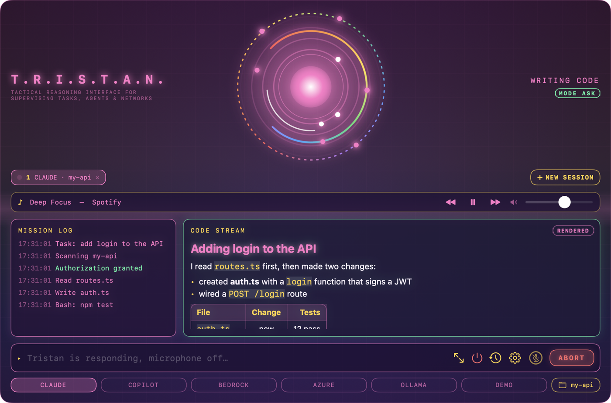

<div align="center">


# T.R.I.S.T.A.N.

**A native macOS harness for AI coding agents, wrapped in an Iron Man style heads-up display.**

**T.R.I.S.T.A.N.** = **T**actical **R**easoning **I**nterface for **S**upervising **T**asks, **A**gents and **N**etworks.

[](https://github.com/mariotristan/jarvis-tristan/actions/workflows/ci.yml) [](https://github.com/mariotristan/jarvis-tristan/actions/workflows/secret-scan.yml) [](LICENSE)          

<p align="center">
  <a href="https://mariotristan.github.io/jarvis-tristan/"></a>
  <a href="https://github.com/mariotristan/jarvis-tristan/releases/latest"></a>
  <a href="https://mariotristan.github.io/jarvis-tristan/install.html"></a>
  <a href="https://github.com/mariotristan/jarvis-tristan/issues/21"></a>
</p>

<p align="center">
  <b>Guides:</b>
  <a href="https://mariotristan.github.io/jarvis-tristan/providers.html">Providers</a> ·
  <a href="https://mariotristan.github.io/jarvis-tristan/approvals.html">Approvals</a> ·
  <a href="https://mariotristan.github.io/jarvis-tristan/local-models.html">Local models</a> ·
  <a href="https://mariotristan.github.io/jarvis-tristan/kids-mode.html">Kids safe mode</a> ·
  <a href="https://mariotristan.github.io/jarvis-tristan/iphone-ipad.html">iPhone and iPad</a> ·
  <a href="https://mariotristan.github.io/jarvis-tristan/install.html">Install</a> ·
  <a href="https://mariotristan.github.io/jarvis-tristan/audio-crackle.html">Audio crackle bug</a>
</p>

</div>

You give T.R.I.S.T.A.N. a task ("add login to the API"). It works inside a project folder on your Mac, the way Claude Code does. You watch it think, write code and run commands through a glowing HUD, a notch overlay and a lot of animation. Before it edits files or runs commands, it asks you first.

> **Just for fun.** T.R.I.S.T.A.N. is a hobby project and a learning experiment that I build together with my kids. We pick the features, draw the themes, and try things to see what happens. That is why there is a Paw Patrol-style theme, a kids safe mode and a lot of sound effects. It is not a commercial product, and it comes with no promises beyond the [MIT license](LICENSE). Ideas, issues and pull requests are very welcome.

> **Status: early experiment.** All five providers are built (Claude Code, Copilot, Bedrock, Azure OpenAI and local models through Ollama) plus a demo provider, together with the HUD, notch overlay, approvals, history, notifications and voice. 441 automated tests pass (424 Swift package tests on the Mac: 124 for the app, 205 for the portable core and 95 for the command line; and 17 for the iOS app), and there is an **iPhone and iPad app** (a remote for the Mac, plus a standalone mode) that runs in the simulator, but **only Claude Code and Azure OpenAI have been run against the real service end to end** (Copilot too, in `AUTO` mode). Bedrock, Ollama, Copilot's `ASK` mode, the wake word and notifications are covered by tests with fakes and still need a live run. See [known limitations](#known-limitations) for exactly what is and is not verified. A **Windows terminal version** (`tristan`) is released in [0.6.1](https://github.com/mariotristan/jarvis-tristan/releases/tag/v0.6.1) as an installer and a zip. It is built and tested on a Windows machine in CI, but it has not been run on a real Windows 10 or 11 desktop or against any live provider on Windows: see [Windows](#windows).

## Demo videos

Recordings of the real app on the built-in demo provider (no account or tokens needed). Click a picture to play the video.

**A task from start to finish** (37 s): the orb grows and sends out rings while T.R.I.S.T.A.N. works, the microphone stays off until it has answered, and the orb can fill the whole window.

[](docs/demo/tristan-demo.mp4)

**Kids safe mode** (64 s): the Paw Patrol-style theme, school questions answered, and a parent PIN needed to open Settings.

[](docs/demo/tristan-demo-kids.mp4)

Record them again with `scripts/record-demo.sh` and `scripts/record-demo.sh kids`. The app plays the scenario by itself (`Tristan --demo`), and the script films just the app window together with the app's own sound (the effects and the voice, nothing else playing on the Mac) and trims the end. It needs Screen & System Audio Recording permission for your terminal, Xcode and ffmpeg. The demo never touches your Keychain and restores your own settings when it ends.

## Screenshots

Rendered from the real views with sample data (`Tristan --snapshot docs/screenshots`).

**The HUD while a mission runs.** Mission log on the left, code stream on the right, arc reactor on top.


**Ask-first approval.** The reactor and borders turn amber until you approve or deny.


**Configuration.** Choose how much supervision a run gets.


**Several sessions at once.** Each tab has its own provider, folder, log, code stream and approvals; the amber banner flags a session that is waiting in the background.


**Full screen and rendered markdown.** Full screen fills the display with larger text; the code stream renders markdown (headings, lists, tables, quotes, code cards with syntax colours and a copy button) and has a RAW switch.


**Mission history.** Past missions with one-click re-run.


**The Pride theme.** A rainbow look for LGBTQ+ users: the reactor's rings become a color wheel and a faint rainbow washes the background. Pick it under **Configuration > THEME**.



**T.R.I.S.T.A.N. on iPhone and iPad.** Approve from your phone while the Mac does the work (see [iPhone and iPad](#iphone-and-ipad)).

<p>
  
  
  
</p>


**The notch overlay**, expanded. It opens by itself when approval is needed, so you can answer without switching windows.


## Why

Agent CLIs are powerful but plain. T.R.I.S.T.A.N. is a nicer front door for them: one Mac-native app that can sit around the camera notch, summon with a shortcut, and show you what an agent is doing instead of scrolling terminal text. It is also meant to be fun, and it is a family learning project: I am building it with my kids, who test it, name things and decide what the next idea should be.

## Features

- **Full HUD window** with three areas:
  - **Mission log** on the left, a timestamped list of steps.
  - **Code stream** on the right, showing code as the agent writes it.
  - **Arc reactor** at the top, which spins and pulses faster while the agent works and turns amber, green or red for waiting, done or failed.
  - Animated grid and scanline backdrop.
- **Notch overlay.** A black pill around the camera notch with a mini reactor and a status dot. It lives on your primary display (the one with the menu bar), and so does the HUD when it opens. Hover to expand it; it opens at once, stays open while the pointer is near, and the reactor animates at a lower frame rate so it stays light on the CPU. It also opens by itself when approval is needed and for a few seconds when a mission ends. On Macs without a notch it becomes a floating pill at the top centre of the screen.
- **Ask-first approvals.** Every action Claude Code wants permission for shows up as an approve or deny prompt, in the HUD or in the notch.
- **Always allow.** The approval prompt has an `ALWAYS ALLOW` button that remembers a narrow rule so you are not asked again (see [how approvals work](#how-approvals-work)). Rules are saved between launches and listed in the configuration panel, where you can remove them one by one or clear them all.
- **Approval modes** (gear button, saved between launches):
  - `ASK`: T.R.I.S.T.A.N. asks before each action. This is the default.
  - `AUTO`: routine actions run without asking and risky ones are blocked or still ask (Claude: its own safety classifier; Bedrock and Azure: in-folder writes and plain commands; Copilot: a short allow-list).
  - `YOLO`: all permission checks are skipped. Needs an explicit confirmation to turn on and shows a red badge.
- **Movie-style sound and voice.** Synthesised sci-fi sounds (power-up, approval ping, mission complete, failure) and short spoken lines in a British voice: "On it, sir.", "Authorization required.", "Mission complete." Both can be switched off in Configuration. Run `Tristan --sound-demo` to hear every cue.
- **Voice (push-to-talk).** Hold `⌥ ⇧ Space` and speak, release to send, or click the mic button. The transcript appears live in the input field and the notch. For tasks started by voice, T.R.I.S.T.A.N. reads the result aloud.
- **The microphone shuts while T.R.I.S.T.A.N. answers.** From the moment you send a command, push-to-talk, the hotkey and the wake word are blocked until T.R.I.S.T.A.N. has finished working and speaking (plus a moment), so it never hears itself or starts a second command. The mic button shows a slashed mic meanwhile.
- **Wake word (optional, off by default).** Say "Hey Tristan, …" and stop talking; T.R.I.S.T.A.N. sends the command after a short silence. It uses on-device speech recognition only, so audio never leaves your Mac, and it pauses while a mission runs.
- **Mission history.** Every finished, failed or aborted mission is saved (task, provider, mode, a short summary and the folder, never code or file contents) and can be searched, filtered by outcome and re-run in one click. The file is private to you (`0600`) in Application Support.
- **Spotify (optional).** A now-playing strip with previous, play/pause, next and volume for the Spotify desktop app. Say or type short commands such as "play music", "pause", "next song", "volume 40", "what's playing" or "play my focus playlist" (set a playlist link in Configuration). These never start a coding mission and work while one is running. The music is turned down while T.R.I.S.T.A.N. talks or listens and restored afterwards. Works with free and Premium accounts, and needs no login or API keys (see [Spotify](#spotify)).
- **Mac notifications** when approval is needed or a mission ends while T.R.I.S.T.A.N. is in the background. Clicking one brings the HUD forward.
- **Global shortcut.** `⌥ Space` shows or hides the HUD from any app, and `Esc` stops a running mission first, then leaves full screen, then hides the HUD. Pick a preset or record your own combination in Configuration; T.R.I.S.T.A.N. tells you if another app already owns it.
- **Launch at login** switch for the installed app.
- **iPhone and iPad remote.** Start missions, watch the HUD, approve or deny actions and control Spotify from your phone or iPad, over an encrypted connection to the Mac (see [iPhone and iPad](#iphone-and-ipad)).
- **Several sessions at the same time.** Run a Claude session and a Copilot session (or two Claude sessions in different folders) side by side. Each session is a tab with its own provider, folder, mission log, code stream and approvals, and a status light (pulsing cyan while working, amber while it needs you, green when done, red on failure). **+ NEW SESSION** (`⌘T`) opens another, `⌘1`…`⌘9` switch, `⌘W` closes (a running session asks first). A session that needs approval in the background raises an amber banner, a sound, a spoken "Session 2, authorization required" and a notification, and the notch shows and answers it. Up to 8 sessions; the open sessions (provider and folder) come back after a restart. Starting a session in a folder another session is already working in warns you that edits may collide. The approval mode and always-allow rules are shared by all sessions.
- **Rounded buttons you can hit anywhere, and a big, configurable orb.** Every button is clickable over its whole area, not just on its text. While T.R.I.S.T.A.N. waits for the model (or listens to you) the orb grows and, with effects on, adds a breathing halo, pulse rings and orbiting sparks. **Configuration > ORB WHILE WAITING** sets the size (60 to 160%), the effects (off, subtle, full) and **ORB FILLS THE WHOLE SCREEN**, which is **on by default**: while a mission runs the orb covers the window. A red **ABORT MISSION** button stays on top of the orb, and `Esc` stops the mission too (the ABORT button in the command bar still works).
- **Kids safe mode.** **Configuration > KIDS SAFE MODE**. While on, questions are answered by a local Ollama model so they stay on the Mac (see [Local models](https://mariotristan.github.io/jarvis-tristan/local-models.html)), T.R.I.S.T.A.N. speaks as Samantha, a little brighter and slower (for the cleanest sound run `scripts/install-voices.sh en_US` and download Samantha Enhanced), opening Settings needs a parent, and YOLO and AUTO are switched off (the mode goes back to ASK whenever it locks). A parent unlocks with a PIN (4 or more digits, stored hashed in the Keychain) or with Touch ID / the Mac password, whichever you choose. It locks again when Settings close or after 5 minutes, and paired phones cannot change the mode.
- **Session memory.** A finished mission stays in its session's context. Each session keeps the task, the actions taken and the result of its recent missions (the last 12; the newest three in detail, older ones as one line) and puts that briefing in front of the next task, so "now add tests for what you just wrote" works whichever provider runs it. Only missions from the same folder are included. The tab shows **REMEMBERS n**; click it (or open **+ NEW SESSION**, which starts empty) to forget. The memory survives a restart. On the iPhone and iPad standalone mode the same memory is kept, and **NEW CONVERSATION** in Settings clears it. The briefing is plain text in the prompt, so it costs a few thousand characters per mission at most; it is not the model's own hidden state, so details that never reached the log or the final reply are not remembered.
- **Full screen.** The expand button in the command bar, `⌃⌘F`, or the menu bar item fills the whole screen, hides the Dock and menu bar completely (they do not slide in at the edges) and puts the window above everything else, starts below the camera notch and makes the text larger. `Esc` leaves it (and so does hiding the HUD, so the Dock never stays hidden).
- **Rendered markdown in the code stream.** What an agent writes is shown as it would read: headings, bold and italic, inline code, bullet, numbered and task lists, tables with alignment, quotes, rules, and code blocks as cards with the file name, language and a COPY button. A file the agent writes is a card too, and a written `.md` file is rendered with a SOURCE switch. **RAW** shows the plain text. Links only open if they are web or mail links, so model output can never plant a `tristan://` pairing link or a `file://` link. The iPhone and iPad apps use the same renderer.
- **Greeting.** When the app opens, T.R.I.S.T.A.N. greets you aloud and in the mission log, for example "Good evening, sir. It is 7:42 PM on a Friday. Friday, sir. The weekend is within reach." The opening depends on the time of day (morning, afternoon, evening, late night, including "Welcome home, sir." from the first Iron Man film), it states the time and weekday, and the closing remark varies by hour and by day of the week. Speech follows the voice feedback setting, so turn **VOICE FEEDBACK** off in Configuration for a silent start. Finishing a mission can also end with "As always, sir, a great pleasure watching you work."
- **Quitting.** Several ways, so you are never stuck, even in full screen: `⌘Q` (while the HUD is in front), the red power button in the command bar, the red **QUIT** button that appears when you hover the notch, typing or saying "quit", "exit" or "close Tristan", or **Quit Tristan** in the menu bar item. There is no confirmation, even if a mission is running.
- **Themes.** Not everyone likes cyan on near-black. **Configuration > THEME** switches the whole HUD, the notch accents and the rendered markdown between 32 looks, each previewed in its own colors: Tristan (the original), Deep Blue, Graphite, Light and High contrast; **Pride**, a rainbow theme for LGBTQ+ users, where the orb's rings turn into a color wheel and a faint rainbow washes the background; pop culture (Tron, WarGames, The Simpsons, Futurama, Iron Man, Terminator, Power Rangers, Superman, Batman, Hackers, The Matrix, Peanuts, Dilbert, Garfield, Paw Patrol); dark classics (Dracula, Nord, Tokyo Night, Catppuccin, Gruvbox, Solarized Dark, Monokai, Rosé Pine); and light ones (GitHub Light, Solarized Light, Catppuccin Latte). **Match system** uses T.R.I.S.T.A.N. in dark mode and Light in light mode, and follows the switch live. The choice is remembered. A unit test checks that every palette keeps its text at 4.5:1 contrast or better on its backgrounds. Each theme also greets you in its own voice: an empty session (and the notch, when idle) shows one of a few welcome lines for the theme, such as "Wake up. The code is waiting." for The Matrix, and every session keeps its own line. The notch pill itself stays black so it blends with the camera notch.
- **Remembered settings.** Provider, approval mode, default folder, shortcut, sound and voice settings and provider details survive restarts. Secrets live in the Keychain.
- **A clean voice.** The spoken lines use the best installed British voice, so install an **Enhanced** one: the built-in compact voices are low quality and can crackle. `scripts/install-voices.sh` opens the right Settings pane, waits for the download and plays a sample, and Configuration shows an amber hint while only compact voices exist. Speech runs at a lower level than full volume so it never clips, sound effects wait for or sit under the voice instead of overlapping it, and the audio output is kept open so lines do not click at their start or end. The full story, with measurements, is the [audio crackle report](https://mariotristan.github.io/jarvis-tristan/audio-crackle.html).
- **Offline fallback.** When the Mac has no internet, an amber **NO INTERNET · USING OLLAMA** note appears in the header and missions on Claude Code, Copilot, Bedrock or Azure OpenAI run on your local Ollama model instead. If Ollama is off, T.R.I.S.T.A.N. starts it for you (it runs `scripts/setup-ollama.sh --start-only`, which installs and downloads nothing) and the mission log says it is working on the fallback. If Ollama is not installed or has no model, it tells you what to run once you are online.
- **Menu bar item** next to the clock to open T.R.I.S.T.A.N. or quit.
- **Provider switcher** along the bottom of the HUD.
- **Folder picker** to choose the project folder the agent works in.

## Providers

| Provider | Status | How it works |
|----------|--------|--------------|
| `DEMO` | Working | Scripted run with a fake approval, for trying the HUD without spending tokens. |
| `CLAUDE` | Working | Runs `claude -p <task> --output-format stream-json --verbose` in the chosen folder and turns the JSON events into log lines and code. In `ASK` mode, permission prompts are routed back to you (see [how approvals work](#how-approvals-work)). |
| `BEDROCK` | Built, needs live validation | T.R.I.S.T.A.N.'s own agent loop on Bedrock's Converse API (see [Providers](https://mariotristan.github.io/jarvis-tristan/providers.html)). Covered by tests with a scripted model; not yet run against real AWS. |
| `COPILOT` | Built, needs live validation | Drives the GitHub Copilot CLI headlessly. Approval modes map onto the CLI's tool permissions (see [Providers](https://mariotristan.github.io/jarvis-tristan/providers.html)). |
| `OLLAMA` | Built, needs live validation | T.R.I.S.T.A.N.'s own agent loop on a model running on this Mac through [Ollama](https://ollama.com), so nothing leaves the machine (see [Local models](https://mariotristan.github.io/jarvis-tristan/local-models.html)). Covered by tests with a scripted model; not yet run against a real Ollama model. |
| `AZURE` | Working (tested live on the Mac) | T.R.I.S.T.A.N.'s own agent loop on an Azure OpenAI deployment, streaming tokens, tested against a real deployment with an API key (see [Providers](https://mariotristan.github.io/jarvis-tristan/providers.html)). |

Claude Code runs its own agent loop, so T.R.I.S.T.A.N. only has to drive it and display the output. Bedrock, Azure OpenAI and Copilot's models are models, not agents, so T.R.I.S.T.A.N. runs its own small agent loop for them (built for Bedrock, reusable for the rest).

### Setting up each provider

The full setup, limits and what has been tested for each provider are in the [Providers guide](https://mariotristan.github.io/jarvis-tristan/providers.html). In short:

- **Claude Code:** install and sign in to the [Claude Code CLI](https://docs.claude.com/en/docs/claude-code). T.R.I.S.T.A.N. finds `claude` on `PATH`, `/opt/homebrew/bin` or `/usr/local/bin`.
- **Azure OpenAI:** set the endpoint, deployment name and API version in Configuration. Paste an API key (stored in the Keychain) or leave it blank to use `az login`. The deployment's model must support tool calling. The key is only sent to `https` Azure hosts.
- **Ollama (local models):** run `scripts/setup-ollama.sh`, pick `OLLAMA`, choose a model in Configuration. Nothing leaves the Mac. See the [Local models guide](https://mariotristan.github.io/jarvis-tristan/local-models.html) or [docs/ollama.md](docs/ollama.md).
- **GitHub Copilot:** `npm install -g @github/copilot`, run `copilot` once to sign in. Its headless mode cannot ask per action, so T.R.I.S.T.A.N. asks once and blocks risky commands. See [Approvals](https://mariotristan.github.io/jarvis-tristan/approvals.html).
- **AWS Bedrock:** set the model id, region and optional profile; it calls the AWS CLI so your usual login works. Not yet run against live AWS.

**Kids safe mode and Ollama.** While kids safe mode is on, every question goes to Ollama so a child's questions stay on the Mac. With no usable local model nothing is sent: the child is told to ask a parent, who can allow one question to go to the cloud. See the [Kids safe mode guide](https://mariotristan.github.io/jarvis-tristan/kids-mode.html).

### Spotify

T.R.I.S.T.A.N. controls the **Spotify desktop app** through AppleScript, so there is no login, API key or Premium requirement. Turn on **SPOTIFY PLAYER** in Configuration. The first time, macOS asks whether T.R.I.S.T.A.N. may control Spotify; if you decline, allow it later in **System Settings > Privacy & Security > Automation**.

- Control commands (pause, next, volume) never launch Spotify. Only an explicit "play music" or "play my focus playlist" starts it.
- The focus playlist accepts a `spotify:playlist:…` URI or an `open.spotify.com` share link. Only well-formed identifiers are ever passed to AppleScript, so nothing else can be injected.
- **Ducking:** while T.R.I.S.T.A.N. speaks or listens, Spotify drops to about 30% and returns afterwards. If you change the volume yourself during that time, T.R.I.S.T.A.N. leaves your choice alone. Switch it off with **LOWER MUSIC WHEN I TALK**. If the app quits mid-duck, it restores the volume first.
- Commands only match whole short phrases, so a real task such as "add a pause button to the player" is never mistaken for a music command.

## iPhone and iPad

The iOS app is a **remote for the Mac**: the Mac does the real work with every provider, and the phone shows the HUD, answers approvals with large buttons and haptics, starts missions, switches provider, mode and folder, controls Spotify and browses history. Without a Mac, a **standalone mode** talks to Azure OpenAI or Bedrock directly, with file tools but no shell. Pair by switching **REMOTE CONTROL** on in the Mac's Configuration and scanning the QR code.

The link is TLS with a pre-shared key held in the Keychain on both sides; it is off by default, a phone cannot turn on `YOLO`, and **NEW SECRET** locks out every paired device. Approvals only reach the phone while the app is open in front, and it has been run in the **iOS simulator only**, not on a physical device.

The full guide (pairing, security, limits, standalone mode, running the simulator) is [iPhone and iPad](https://mariotristan.github.io/jarvis-tristan/iphone-ipad.html). The design is in [docs/superpowers/specs](docs/superpowers/specs/2026-11-06-ios-remote-design.md). Run it in the simulator with `scripts/ios-demo.sh`; the iOS project is generated with `cd ios && xcodegen generate` (needed whenever a file is added to or removed from `Sources/Tristan/Shared` or `Sources/TristanCore`; CI fails if the committed project is out of date).

## Install

### Requirements

- **The app:** an **Apple Silicon** Mac on macOS 14 or later. Building from source needs the full Xcode.
- **The `tristan` command on Windows:** the target is Windows 10 or 11, x64; so far CI has run it only on Windows Server 2025. Download the installer or the portable zip from [the latest release](https://github.com/mariotristan/jarvis-tristan/releases/latest), or build it from source with Swift 6.4.2 (see [Windows](#windows)).
- **Providers:** the CLI or account for each provider you use (Claude Code, the Copilot CLI, the AWS CLI, an Azure OpenAI deployment, or Ollama). Nothing is needed for the `DEMO` provider in the app.

The full guide, with every script and troubleshooting, is [Install](https://mariotristan.github.io/jarvis-tristan/install.html).

**From a release (no Xcode needed).** Download `Tristan-<version>.dmg` from the [Releases page](https://github.com/mariotristan/jarvis-tristan/releases), then:

```bash
cd ~/Downloads && shasum -a 256 -c Tristan-0.6.2.dmg.sha256      # optional: check the download
hdiutil attach ~/Downloads/Tristan-0.6.2.dmg
cp -R "/Volumes/Tristan 0.6.2/Tristan.app" /Applications/
xattr -dr com.apple.quarantine /Applications/Tristan.app          # Tristan is ad-hoc signed, not notarized
open /Applications/Tristan.app
```

If you skip the `xattr` step, macOS says the app "cannot be opened". You can also allow it under **System Settings > Privacy & Security > Open Anyway**.

**From source** (needs the full Xcode, not just the command line tools, because SwiftUI's macros need it):

```bash
git clone https://github.com/mariotristan/jarvis-tristan.git
cd jarvis-tristan
scripts/install.sh      # builds, copies Tristan.app into /Applications and launches it
scripts/bundle.sh       # or just build Tristan.app here
scripts/uninstall.sh    # remove installed copies (add --purge for settings, history and Keychain items, --build for build output, --dry-run to preview)
scripts/install-voices.sh   # get an Enhanced voice for clean speech (see the audio crackle report)
DEVELOPER_DIR=/Applications/Xcode.app/Contents/Developer swift build   # a quick debug build
```

Maintainers: `scripts/make-dmg.sh` builds the DMG and `git tag vX.Y.Z && git push origin vX.Y.Z` publishes a release. See [docs/ci-and-release.md](docs/ci-and-release.md). T.R.I.S.T.A.N. has no Dock icon: look for the notch overlay, the menu bar icon, or press `⌥ Space`.

**Uninstall (and removing test versions).** `scripts/uninstall.sh` quits the app and removes installed copies, including ones Spotlight finds elsewhere and mounted disk images. It lists everything and asks first. `--purge` also removes settings, history, caches, the pairing secret and API keys in the Keychain; `--build` removes build output in a checkout; `--dry-run` only lists. Ollama and its models are left alone.

## Windows

On Windows, T.R.I.S.T.A.N. is a terminal command, `tristan`, not a window. It runs the same core as the Mac app (the agent loop, all five providers and the approval rules) and asks about each action in Windows Terminal, PowerShell or cmd. **It is released as 0.6.1, as an installer (recommended) and as a portable zip.** It is built and tested on GitHub Actions Windows Server 2025 against fake provider CLIs and a mocked Ollama. It has not been run on a real Windows 10 or 11 desktop, and no provider has run against a live account on Windows.

**Install (recommended).** Get `Tristan-0.6.2-windows-x64-setup.exe` and its `.sha256` file from [the latest release](https://github.com/mariotristan/jarvis-tristan/releases/latest), check it, run it, leave "Add Tristan to my PATH" ticked, then open a **new** terminal:

```powershell
cd ~\Downloads
(Get-FileHash -Algorithm SHA256 Tristan-0.6.2-windows-x64-setup.exe).Hash   # compare with the hash inside Tristan-0.6.2-windows-x64-setup.exe.sha256 (hex case does not matter)
.\Tristan-0.6.2-windows-x64-setup.exe                                       # the installer; SmartScreen may warn, see below
tristan --version                                                       # in a new terminal: prints 0.6.2
tristan providers
```

It installs for you alone by default (into `%LocalAppData%\Programs\Tristan`, no administrator rights); choose all users in the dialog or pass `/ALLUSERS` for everyone. For a silent install:

```powershell
.\Tristan-0.6.2-windows-x64-setup.exe /VERYSILENT /CURRENTUSER /TASKS="addtopath"
```

Uninstall in Settings, Apps. Your settings and history in `%APPDATA%\Tristan` and your stored secrets are kept; to remove them too, delete that folder and run `tristan secret delete azure-openai-key` (and any other key you stored) before uninstalling.

**Portable, no install.** Get `Tristan-0.6.2-windows-x64.zip` and its `.sha256` file from the same release, then in PowerShell:

```powershell
cd ~\Downloads
(Get-FileHash -Algorithm SHA256 Tristan-0.6.2-windows-x64.zip).Hash   # compare with the hash inside Tristan-0.6.2-windows-x64.zip.sha256
Expand-Archive Tristan-0.6.2-windows-x64.zip -DestinationPath $HOME\Tristan
$env:Path += ";$HOME\Tristan"                 # this window only; add the folder to PATH in Settings to keep it
tristan --version                              # prints 0.6.2
tristan providers
```

Neither file is code-signed, so Windows SmartScreen may warn the first time you run it (we have not seen what it shows on a real Windows desktop). In CI the installer was tested only with silent installs, on Windows Server 2025; nobody has gone through the wizard screens. Both are x64 only; MSIX, winget and code signing are on the roadmap.

To build from source instead:

```powershell
swift build --product tristan                          # Swift 6.4.2 with Visual Studio's C++ tools and a Windows SDK
swift test --filter TristanCoreTests                   # 230 tests on the Windows runner
swift test --filter TristanCLITests                    # 109 tests on the Windows runner
pwsh -File scripts\package-windows.ps1 -Version 1.2.3  # dist\Tristan-1.2.3-windows-x64.zip and .sha256
tristan providers                                      # which providers are ready
tristan config set ollama.model llama3.1               # provider settings (no Configuration window on Windows)
tristan secret set azure-openai-key                    # typed at a hidden prompt, kept in Credential Manager
tristan run --provider claude "fix the failing test"   # approve with [y]es / [n]o / [a]lways in the terminal
```

Exit status: 0 done, 1 failed, 2 usage error, 3 something was denied, 130 cancelled. With no terminal attached, every action that needs approval is denied unless `--yes-routine` or `--yolo` is given. `tristan kids on|off|set-pin|status`, `tristan history` and `tristan sessions` work as on the Mac. `scripts/setup-ollama.ps1` sets up Ollama. The full guide, with the support matrix, the roadmap and how the port was built, is [Windows](https://mariotristan.github.io/jarvis-tristan/windows.html).

## Using it

1. Pick a provider along the bottom. Start with `DEMO` to see everything move.
2. Click the folder button to choose the project folder.
3. Type a task and press Return or click **EXECUTE**.
4. Approve or deny when asked, in the HUD or from the notch.
5. Watch the mission log and code stream. Click **ABORT** to stop a run.

| Key | Action |
|-----|--------|
| `⌥ Space` | Show or hide the HUD from anywhere |
| `Esc` | Leave full screen, or hide the HUD |
| `⌃⌘F` | Full screen on and off |
| `⌘Q` | Quit Tristan (also: the power button, the notch QUIT button, or type "quit") |
| `⌘T` / `⌘W` | New session / close the current session |
| `⌘1`…`⌘9` | Switch to that session |
| `Return` | Execute the task |
| Hold `⌥ ⇧ Space` | Push-to-talk, release to send |

## How it works

```
Sources/TristanCore/          The portable core, used by the Mac app, the iOS app (by path) and the tristan command
├── AgentLoop.swift           The shared agent loop and provider-neutral transcript types
├── AgentTools.swift          Sandboxed file and shell tools, safe-path resolution, tool policy per mode
├── AgentTypes.swift          Events, approval requests and the narrow always-allow rules
├── ShellFlavor.swift         zsh or PowerShell, and the approval policy for each (never-generalise lists, operators)
├── PathContainment.swift     Folder containment for POSIX and Windows paths
├── Settings.swift            UserDefaults on Apple platforms, %APPDATA%\Tristan\settings.json on Windows
├── Keychain.swift            Keychain on Apple platforms, Credential Manager on Windows
├── AzureProvider.swift       Azure OpenAI backend, streaming HTTP client, SSE assembler, config validation
├── BedrockBackend.swift, BedrockStreaming.swift   Bedrock: Converse format, SigV4 signer, event-stream decoder
├── OllamaProvider.swift      Ollama (local) client, model discovery and provider
├── AsyncBytesCompat.swift    URLSession and FileHandle byte streams where Apple's Foundation is not available
├── ConversationMemory.swift, HistoryStore.swift, CodeFence.swift, KidsRouting.swift, ParentPIN.swift, Models.swift
└── Processes/                Everything that starts a process or opens a socket (not compiled into the iOS app)
    ├── ClaudeCodeProvider.swift, CopilotProvider.swift, BedrockProvider.swift   The CLI-driven providers
    ├── ProcessLauncher.swift   Finds tools on PATH (PATHEXT and npm shims on Windows) and starts them
    ├── ProcessTree.swift, PipeDrain.swift   Stopping a whole process tree; waiting without waitUntilExit
    ├── ShellRunner.swift       zsh -c on the Mac, PowerShell on Windows
    ├── ApprovalTransport.swift, PermissionBridge.swift   The Claude Code approval channel (Unix socket, or loopback TCP with tokens)
    └── WindowsCredentialStore.swift   Credential Manager through WinSDK
Sources/TristanCLICore/       The tristan command: run, providers, config, secret, kids, history, sessions, terminal approvals
Sources/TristanCLI/           Its entry point (tristan on Windows and Linux, tristan-cli on the Mac)
Sources/Tristan/              The Mac app (macOS only)
├── main.swift                App entry point (accessory app, no Dock icon)
├── AppDelegate.swift         HUD window, menu bar item, global hotkey, notch setup
├── Session.swift             The hub: shared settings and services, the open sessions, sound/notification/history callbacks
├── MissionSession.swift      One session: provider, folder, log, code, approvals and the task that runs it
├── Providers.swift           The DEMO provider
├── KidsMode.swift            Kids mode: the parent lock (PIN, Touch ID or password) and its questions
├── Connectivity.swift        Internet monitor and the Ollama starter behind the offline fallback
├── HUDView.swift, SettingsView.swift, FullScreen.swift, Notch.swift   The window, Configuration, full screen and the notch
├── Audio.swift, Voice.swift, WakeWord.swift, Greeting.swift   Sound, push-to-talk, "Hey Tristan" and the spoken greeting
├── Spotify.swift, Notifier.swift, Shortcut.swift, HotKey.swift   Spotify, notifications and the global shortcut
├── RemoteServer.swift, QRCode.swift   Mac side of the iPhone/iPad remote and its pairing code
├── Snapshot.swift, DemoAutopilot.swift   README screenshots and the recorded demo
└── Shared/                   Compiled by the Mac and iOS apps: themes, the markdown parser and views, the remote protocol and client
Tests/TristanTests/           137 tests for the Mac app (macOS only)
Tests/TristanCoreTests/       206 tests on the Mac, 230 on Windows (files whose names start with Windows run only there)
Tests/TristanCLITests/        95 tests on the Mac, 109 on Windows
ios/                          The iPhone and iPad app (XcodeGen project, standalone engine, 17 tests)
scripts/                      bundle.sh (app), make-dmg.sh (installer), install.sh (build and install), setup-ollama.sh and setup-ollama.ps1 (local models; `--start-only` / `-StartOnly` just starts it), package-windows.ps1 (Windows zip), package-windows-installer.ps1 (Windows installer), install-voices.sh (Enhanced voice), uninstall.sh (remove test versions), record-demo.sh with record-window.swift (films the window and the app's own sound), ios-demo.sh, ios-icon.sh, ci/ (Windows CI fakes, the Ollama mock and the spike tools)
VERSION                       Version number used by the scripts
docs/ci-and-release.md        How CI and releases work
docs/superpowers/             Design specs, plans and the Windows spike notes
.github/workflows/            CI on macOS, Windows CI, a gitleaks secret scan on every push, PR and week (it also gates releases), and the release
```

A provider turns a task into a stream of events:

```swift
protocol AgentProvider: Sendable {
    func run(task: String, workingDirectory: URL, approve: @escaping Approver) -> AsyncStream<AgentEvent>
}

enum AgentEvent { case status(String), log(String), code(String), done(String), failed(String) }
```

`Session` consumes that stream and publishes state. The HUD and the notch both render from the same `Session`, so they always agree. A provider asks for permission by calling `approve(...)`, which suspends until you tap Approve or Deny.

### How approvals work

In `ASK` mode T.R.I.S.T.A.N. starts Claude Code with a permission-prompt tool that points at **its own binary** (`Tristan --mcp-permission <socket>`). Claude Code calls it, the helper forwards the request over a private Unix socket (a `0700` temp folder) to the running app, the app shows it in the HUD or notch, and your answer goes back as allow or deny. `AUTO` and `YOLO` skip the bridge. On Windows the same shim talks to the host over loopback TCP on `127.0.0.1` instead. Two random tokens, one for each side, reach it through the MCP config's `env` block, and the per-run folder's access list has a single entry, for the current user (administrators and SYSTEM can still reach it).

**Always allow rules are deliberately narrow.** They are offered only for file edits inside the working folder and for plain program names (for example `npm`), never for chained or redirected shell commands or risky programs such as `rm`, `sudo`, `curl` or `ssh`. The full explanation, with the table of what each rule remembers, is in the [Approvals guide](https://mariotristan.github.io/jarvis-tristan/approvals.html).

### Running the tests

```bash
DEVELOPER_DIR=/Applications/Xcode.app/Contents/Developer swift test   # 438 tests: TristanTests, TristanCoreTests, TristanCLITests
```

On Windows: `swift test --filter TristanCoreTests` and `swift test --filter TristanCLITests` (the Mac app and its tests are only declared on macOS).

The Bedrock agent loop is tested end to end with a scripted fake model: approvals in every mode, denied actions reaching the model, sandbox and symlink escapes, the turn limit and error handling.

### Testing without the UI

```bash
# Drives a real Session without any window. The last argument answers approvals (allow, deny, always)
# or picks a mode (auto, yolo)
.build/debug/Tristan --headless /path/to/folder "Use Bash to run: echo hi > out.txt" deny
```

### Adding a provider

1. Create a type conforming to `AgentProvider` in its own file in `Sources/TristanCore` (in `Sources/TristanCore/Processes` if it starts a process, so the iOS app does not compile it).
2. Emit `AgentEvent`s as work happens. Call `approve(...)` before anything with side effects.
3. Add a case to `ProviderKind` (`Sources/Tristan/Providers.swift`) and return your provider from `makeProvider()`. For the `tristan` command, also add it to `CLIProvider` (`Sources/TristanCLICore/ProviderFactory.swift`).

## Known limitations

**On Windows**, nothing has been verified live yet: the `tristan` command is proven only on a CI runner, with fake provider CLIs and a mocked Ollama. The [Windows guide](https://mariotristan.github.io/jarvis-tristan/windows.html#support) has the full matrix.

**What has actually been verified live:** the Claude Code provider (all modes, including per-action approvals), the Azure OpenAI provider on the Mac (streaming and tool calls against a real deployment, with an API key), the HUD and the packaged app launching. **Everything below is built and tested with fakes but not yet run against the real thing:**

- **Bedrock** has not run against live AWS (the AWS session was expired when it was built). Request signing is verified against AWS's published examples and the stream decoder against the wire format; the CLI request format was checked against the CLI's own skeleton. If streaming fails it falls back to the CLI path automatically.
- **The offline fallback to Ollama** has been tried live on the Mac: with the internet off, a cloud mission ran on the local model and the **NO INTERNET** note appeared. Starting a stopped Ollama automatically is covered by automated tests and a manual run of `scripts/setup-ollama.sh --start-only`, but the whole flow has not been watched end to end in the app. "Offline" means macOS reports no network route, so a connected Wi-Fi with no real internet may not trigger it.
- **Azure OpenAI** has been tested live from the Mac app with an API key: streaming and tool calls worked against a real deployment. Not yet tried live: sign-in through the Azure CLI (Entra ID, no key) and the iOS standalone mode.
- **Ollama** is covered by tests with a scripted model and by the kids-mode routing tests, but has not been run against a real local model (the server was not running when it was built). The kids-mode voice depends on which voices your Mac has installed. Not built yet: a child-safe system prompt and screening of the model's answers.
- **Copilot** was not launched with real permissions during development. The command-line flags follow the CLI's own help text, and process handling is tested with a stand-in command. Its output format is unstructured, so the HUD shows it as plain text.
- **Wake word, push-to-talk, sound and notifications** build, launch and have unit tests for the logic (matching, timing, synthesis, gating), but have not been heard or seen working by me. Voice needs microphone and speech permission; the wake word needs a language with on-device recognition.
- **`YOLO` is exactly as risky as it sounds.** Do not use it in a folder you cannot afford to lose.
- **Actions you already allowed in your own Claude Code settings are not asked about again** in `ASK` mode.
- **Copilot cannot be approved per action** (see [Providers](https://mariotristan.github.io/jarvis-tristan/providers.html)).
- **Spotify control** is tested against a pretend Spotify (commands, parsing, ducking, error handling) but has not been run against the real app. macOS asks for permission on first use.
- **Launch at login** uses the system login-item service, which may ask you to approve an ad-hoc signed app in System Settings.
- **Several sessions:** two real **Claude Code** sessions ran at the same time, each with its own approval, in its own folder (see the headless check `Tristan --headless-sessions`). Two real **Copilot** sessions also ran together in `AUTO` mode, each creating its own file in its own folder (same driver, `... copilot auto`); in `ASK` mode Copilot's blanket-permission launch was only tested with a stand-in process, not live. Each Copilot run gets its own log directory so concurrent runs never share one. The iPhone and iPad remote controls only the Mac's active session, so approvals for a session in the background reach the phone only after you switch to it on the Mac.
- **Full screen:** the window and Dock behaviour is verified by a real self-test (`Tristan --fullscreen-selftest`) and a unit test, and the layout by a screenshot, but I have not watched it on your display, and the notch inset is only known for the one notched screen it ran on.
- **Markdown:** the renderer covers what agents produce (no images, HTML, footnotes or nested quotes); code cards are coloured for Swift, TypeScript and JavaScript, Python, shell, JSON and YAML, and other languages stay one colour. It is covered by parser tests, a fuzz test and an every-prefix streaming test.
- **iOS standalone mode has never called a real Azure OpenAI or Bedrock endpoint** (Azure OpenAI works live from the Mac app, but the phone's own client is not yet tried): the model is scripted in the tests and in the simulator demo. The Files folder picker and Keychain-stored AWS keys are only tested through unit tests.
- **The iOS app has only run in the simulator** (see [iPhone and iPad](#iphone-and-ipad)): no physical device, no real Wi-Fi, no camera, microphone or haptics. The secure link and the remote commands are tested end to end on loopback, and the remote design rules (no remote YOLO, folder allow-list, replay for late joiners, wrong secret refused) have automated tests.
- **The app is not notarized** (see [Install](#install)); there is no auto-update.
- **Session memory** is covered by unit tests (the briefing, the folder filter, the limits, a restart, and a session briefing its next mission), but I have not tried it live with a real model across several missions. The notch changes (no blinking, faster, primary display) build and pass tests, but I have not watched them on a real screen.
- The notch overlay has only been tested on a notched MacBook, and the visuals have not had a design pass on other displays.
- Sound and voice quality depend on the voices installed on your Mac (a British English voice is preferred).

## Roadmap

Done:

- [x] Per-action approvals for Claude Code, approval modes (ask, auto, yolo) and "always allow"
- [x] Claude Code, Bedrock, Azure OpenAI and Copilot providers
- [x] Shared agent loop with sandboxed file and shell tools for the model-only providers
- [x] Push-to-talk voice, spoken results, sound effects and voice feedback
- [x] Optional on-device "Hey Tristan" wake word
- [x] Mac notifications, mission history with re-run
- [x] Settings: shortcut, default folder, Keychain credentials, remembered choices
- [x] Streaming for Azure OpenAI and, with automatic fallback, for Bedrock
- [x] Shortcut recorder, history search and filters
- [x] Spotify player, voice and typed music commands, ducking, focus playlist
- [x] Installable DMG with icon and versioning, release and CI workflows, install script, launch at login
- [x] iPhone and iPad remote: encrypted pairing, mission screen, approvals, history, music, dictation, side-by-side iPad layout
- [x] iOS standalone mode: Azure OpenAI and Bedrock straight from the device, file tools in a Files folder, no shell
- [x] Sessions remember their finished missions, the notch no longer blinks and uses less CPU, and the app opens on the primary display
- [x] Full-screen mode, rendered markdown in the code stream, several concurrent sessions (verified live with two Claude Code sessions and with two Copilot sessions)
- [x] 30 themes with a picker and Match system, a welcome line per theme and session, a spoken greeting that follows the time and day, and easier ways to quit
- [x] The orb fills the screen by default with an ABORT button and Esc to stop a mission, an offline fallback to Ollama, sound in the demo videos, a cleaner voice (see the [audio crackle report](https://mariotristan.github.io/jarvis-tristan/audio-crackle.html)), a secret scan in CI and an uninstall script
- [x] A rainbow Pride theme (32 themes now)
- [x] Automated tests (442: 425 on the Mac and 17 for iOS; 339 also run on Windows)

Next (every item is a GitHub issue; start from the [backlog overview](https://github.com/mariotristan/jarvis-tristan/issues/21)):

- [x] Live validation of Azure OpenAI on the Mac (API key)
- [ ] Live validation of Azure OpenAI with Entra ID sign-in and from the iOS app
- [ ] Live validation of Bedrock, Copilot's `ASK` mode, wake word, notifications and the iOS app on a real device (needs real credentials and a human in front of the hardware)
- [ ] iOS: Bonjour discovery of the Mac, per-device pairing keys, Live Activities for approvals
- [ ] Several sessions on the iPhone and iPad remote (it controls the Mac's active session for now)
- [x] Syntax highlighting in code cards ([#14](https://github.com/mariotristan/jarvis-tristan/issues/14)), a small built-in scanner for Swift, TypeScript and JavaScript, Python, shell, JSON and YAML
- [ ] Per-action approvals for Copilot, if the CLI gains a permission prompt hook
- [ ] Developer ID signing and notarization (needs a paid Apple Developer account), then a Homebrew cask and auto-update
- [ ] Track title in the notch, and Apple Music support
- [ ] Individual user profiles ([#25](https://github.com/mariotristan/jarvis-tristan/issues/25)) and extra kids mode configuration through markdown files ([#26](https://github.com/mariotristan/jarvis-tristan/issues/26))
- [x] The portable core split into `TristanCore`, and a command-line version, `tristan` ([#24](https://github.com/mariotristan/jarvis-tristan/issues/24)), built and tested on Windows in CI ([#23](https://github.com/mariotristan/jarvis-tristan/issues/23)); released in 0.6.0 as a zip; 0.6.1 adds a `setup.exe` installer ([#30](https://github.com/mariotristan/jarvis-tristan/pull/30))
- [ ] Windows: live checks of each provider on a real PC, live checks on a real Windows desktop, then signing, winget or MSIX and a Windows HUD (see [What is next](https://mariotristan.github.io/jarvis-tristan/windows.html#next))
- [ ] Linux starting with Omarchy ([#22](https://github.com/mariotristan/jarvis-tristan/issues/22)), on the same `tristan` command

## Regenerating the screenshots

```bash
DEVELOPER_DIR=/Applications/Xcode.app/Contents/Developer swift build
.build/debug/Tristan --snapshot docs/screenshots
```

## Security notes

T.R.I.S.T.A.N. runs agents that can change files and run commands on your machine. Review what you approve.

- Secrets (the Azure OpenAI key) are stored in the macOS Keychain (Windows Credential Manager for the `tristan` command), never in the repository or in preferences. Entra ID and AWS logins are borrowed from the Azure CLI and AWS CLI and are never stored by T.R.I.S.T.A.N. Because the app is only ad-hoc signed, macOS may ask for Keychain access again after you rebuild it.
- Every push, pull request and week, the **Secret scan** workflow runs [gitleaks](https://github.com/gitleaks/gitleaks) over the whole git history, and a release cannot be published if it finds a leak. The badge at the top shows its status.
- Mission history stores task text and short summaries, so treat it as private; it is `0600` and can be cleared in the app.
- The wake word is off by default, runs on-device only, and the microphone is released while a mission runs.
- Claude Code actions are gated per action in `ASK` mode, but Copilot's headless mode cannot be (see the [Providers guide](https://mariotristan.github.io/jarvis-tristan/providers.html)).

## License

[MIT](LICENSE) © 2026 Mario Tristan
